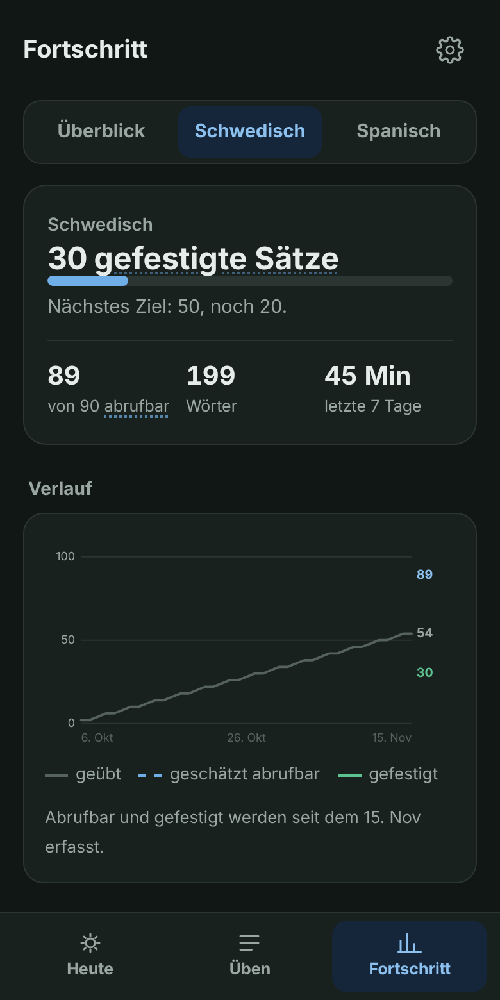
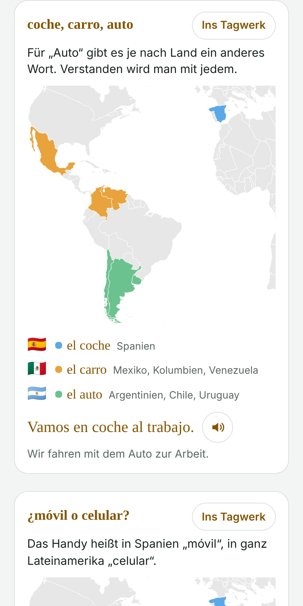

# Tagwerk

Eine Lern-App für **Schwedisch und Spanisch**, die jeden Tag ein kurzes „Tagwerk“ zusammenstellt: neue Sätze, fällige Wiederholungen und gemischte Grammatik. Sie läuft offline auf dem Handy, braucht kein Konto und keine KI und speichert alles nur auf dem Gerät.

<p>




</p>

## Was die App kann

- **Sätze statt Vokabeln**, geplant mit FSRS-6 (dem Verfahren aus Anki), geprüft gegen die offizielle Referenz.
- **Übungsformen:** Wortkästchen, Lücken, freies Übersetzen, Hördiktat, Nachsprechen (hören, mitsprechen, aufnehmen; Tempo und Stocken werden auf dem Gerät ausgewertet, dazu Aussprachehilfen), Fehler finden (richtig oder falsch, dann verbessern), Umbauen, Uhrzeiten & Zahlen, Genus. Grammatik-Generatoren erzeugen beliebig viele neue Aufgaben, ohne sich zu wiederholen.
- **Gezielt zu typischen Fehlern** deutschsprachiger Lernender: Inversion, „inte“ im Nebensatz, Präteritum oder Perfekt, ser oder estar, Subjuntivo, por oder para und mehr. Zu jedem Thema ein Blatt mit Regel, Beispielen und typischem Fehler; Fachbegriffe sind antippbar.
- **Schreiben** mit Textprofil (Zeitformen, Nebensätze, Satzlänge, LIX), treffsicheren Offline-Hinweisen, freiwilligen Extra-Aufgaben und Archiv. Online-Prüfung mit LanguageTool auf Wunsch.
- **Wörterbuch** für jedes angezeigte Wort, offline, mit Beispielen aus den eigenen Sätzen.
- **Land & Leute:** Sprachvarianten, Geografie, Alltag und Gesellschaft, nach Kategorie filterbar, viele mit Karte; Beispielsätze lassen sich in die Wiederholung übernehmen, passende Lesetexte sind verlinkt. Feste mit berechneten Terminen, falsche Freunde.
- **Fortschritt:** Serie mit einem Pausetag pro Woche, Kalender, Lernminuten, Tageszeit, Behalten, Fehlerquellen, Themenraster, „Dein Weg“ mit Etappen, „Jahr für Jahr“ ab dem zweiten Jahr, Entwicklung der eigenen Texte.
- **Lesen und Hören:** kurze Texte zu allem Möglichen, zum Lesen oder nur Hören, mit Verständnisfragen; dazu ein ausgezeichneter Wikipedia-Artikel, bevorzugt mit Bezug zum Land, auch als Lückentext (online).
- **Hörrunde:** geübte Sätze nebenbei hören, Satz, Deutsch, langsam, ohne Antippen.
- **Nachschub** von Tatoeba, sobald die eingebauten Sätze zur Neige gehen: gezielt zu schwachen Themen, bei „Fortgeschritten“ nach B2-Mustern, ohne Sätze, die vorhandenen zu sehr ähneln (online, abschaltbar).

## Auf dem Handy installieren

Siehe [docs/INSTALL.md](docs/INSTALL.md). Kurz: Die sechs Dateien aus `dist/` auf GitHub Pages hochladen, den Link in Chrome oder Firefox öffnen, „App installieren“. Vom Handy mit Termux geht auch das ganze Repository samt automatischer Veröffentlichung (Weg C); Updates kommen dann als eine `.patch`-Datei.

## Entwickeln

Voraussetzung: Node.js 20 oder neuer.

```bash
npm install                 # Entwicklungswerkzeuge (Playwright, ESLint, Kartenwerkzeuge)
npm run build               # → dist/
npm test                    # Einheitstests samt ESLint-Prüfung, ohne Browser (406 Tests)
npx playwright install chromium
npm run test:e2e            # Browser-Tests in Handygröße über lokalen Server (100 Tests)
npm run serve               # lokal unter http://localhost:8080 ansehen
npm run sicht -- --vs origin/main   # Bildschirmfotos aller Ansichten, vorher/nachher
```

Eigenes Chromium statt Download: `CHROMIUM_PATH=/pfad/zu/chrome npm run test:e2e`. Zusätzlich in Firefox: `npx playwright install firefox`, dann `PW_FIREFOX=1 npx playwright test --project=firefox` (Nachsprechen mit vorgetäuschtem Mikrofon nur in Chromium). Die CI prüft Chromium und Firefox in zwei Jobs; beide müssen grün sein.

Weitere Befehle: `npm run icons -- <name>` erzeugt die App-Symbole aus einem Entwurf in `design/icons/`, `npm run geo` erzeugt die Kartendaten neu, `npm run screenshots` die Bilder oben, `npm run lint` die ESLint-Prüfung allein, `node tools/vielfalt.js` die Abwechslung neuer Sätze gegenüber `origin/main`, `node tools/themen-etappen.js` simuliert die Themen-Etappen, `python3 tools/fsrs_reference.py` die FSRS-Referenz (braucht `pip install fsrs==6.3.3`).

## Aufbau

```
src/
  index.html          Gerüst mit Platzhaltern für CSS und JavaScript
  style.css           alle Stile, helles und dunkles Farbschema
  data/               Inhalte: Satzbank, Wörterbuch, Begriffe, Feste, Land & Leute, Kartendaten
  js/                 Logik: Generatoren, Übungsformen, Wiederholung, Prüfung, Statistik, Schreiben, Ansichten
public/               Manifest, Service Worker, Symbole (aus design/icons/, siehe tools/icons.js)
design/icons/         Entwürfe für das App-Symbol als SVG; AKTIV nennt den verwendeten
tools/                Build, ESLint-Prüfung, lokaler Server, Sichtprüfung, Symbole, Kartendaten, FSRS-Referenz, Bildschirmfotos, einspielen.sh (Updates per Termux)
tests/
  unit/               Node-Tests ohne Browser
  e2e/                Playwright-Tests
  helpers/, fixtures/ Lader für die VM, FSRS-Referenzdaten
docs/                 Installation, Architektur, Inhalte, Forschungsgrundlagen, Ideen
CLAUDE.md             Arbeitsweise am Repo: Tests, Lieferung als Patch, Code-Landkarte, festgelegte Entscheidungen
.github/workflows/    CI (Tests) und Pages (Veröffentlichung)
```

Details: [Architektur](docs/ARCHITECTURE.md) · [Inhalte pflegen](docs/CONTENT.md) · [Forschungsgrundlagen](docs/RESEARCH.md) · [Ideen](docs/IDEEN.md) · [Änderungen](CHANGELOG.md) · [Arbeitsweise am Repo](CLAUDE.md)

## Daten und Datenschutz

Der gesamte Lernstand liegt im Speicher des Browsers auf dem Handy. Es gibt kein Konto, keinen Server, keine Tracker und keine fremden Schriften. Nur bei einer Aktion werden Online-Dienste gefragt: Tatoeba (Suchwort bzw. Sprache für Nachschub), LanguageTool (dein Text, nur beim Prüfen), Wiktionary (das nachgeschlagene Wort, nur wenn es nicht im eingebauten Wörterbuch steht) und die Spracherkennung von Chrome (nur bei „Versteht dich die Spracherkennung?“). Aufnahmen beim Nachsprechen bleiben im Arbeitsspeicher des Handys und verschwinden beim Verlassen.

## Quellen und Lizenzen

- Beispielsätze und Aufnahmen von [Tatoeba](https://tatoeba.org) werden zur Laufzeit geladen und mit Urheber und Lizenz angezeigt (CC BY 2.0 FR bzw. CC0; Aufnahmen nach Lizenz der Sprecher).
- Kartendaten: [Natural Earth](https://www.naturalearthdata.com) (gemeinfrei), aufbereitet über [world-atlas](https://github.com/topojson/world-atlas).
- FSRS: Verfahren des Projekts [open-spaced-repetition](https://github.com/open-spaced-repetition); die Umsetzung hier ist eigenständig.
- Satzbank, Wörterbuch, Texte und Code dieser App: eigene Inhalte. Eine Lizenz für das Repository ist noch nicht festgelegt.
